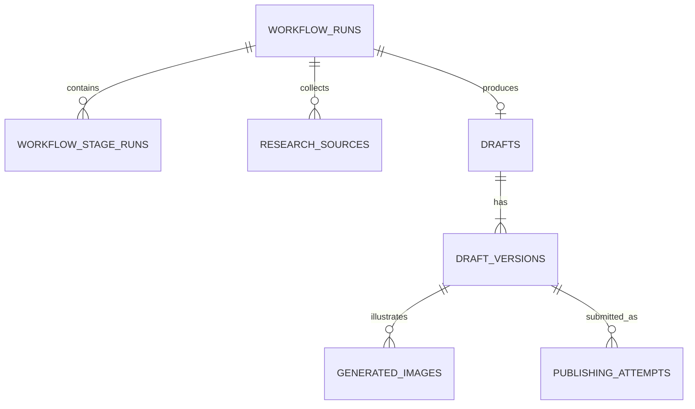

# DATABASE.md — AI Crypto Content Studio

## 1. Technology and Conventions

Use SQLite for the single-user MVP with Python `sqlite3`. Store timestamps as UTC ISO-8601 strings and application-generated UUID identifiers as `TEXT`. Enable foreign keys for every connection, use parameterized SQL, keep database access in `database.py`/`repositories.py`, and use transactions for related state changes. JSON values are stored as validated JSON text. Generated image bytes are stored on disk; the database stores metadata and relative paths.

## 2. Entity Relationships

`APP_SETTINGS` stores non-secret preferences and has no foreign-key relationship to content records.

## 3. Tables

### `workflow_runs`

- `id TEXT PRIMARY KEY`
- `trigger_type TEXT NOT NULL` — `manual` or `scheduled`
- `scheduled_for TEXT NULL`
- `topic TEXT NOT NULL`
- `category TEXT NOT NULL`
- `status TEXT NOT NULL` — pending, running, completed, completed_with_warnings, failed, cancelled
- `current_stage TEXT NULL`
- `started_at TEXT NOT NULL`
- `completed_at TEXT NULL`
- `error_code TEXT NULL`
- `error_summary TEXT NULL` — sanitized
- `research_metadata_json TEXT NOT NULL DEFAULT '{}'` — creation timestamp, market snapshots, suggested topics, and research warnings not represented by source rows

### `workflow_stage_runs`

- `id TEXT PRIMARY KEY`
- `workflow_run_id TEXT NOT NULL REFERENCES workflow_runs(id) ON DELETE CASCADE`
- `stage TEXT NOT NULL`
- `status TEXT NOT NULL` — pending, running, completed, completed_with_warnings, failed, skipped
- `attempt_number INTEGER NOT NULL CHECK (attempt_number > 0)`
- `started_at TEXT NOT NULL`
- `completed_at TEXT NULL`
- `error_code TEXT NULL`
- `error_summary TEXT NULL`
- Unique constraint on `(workflow_run_id, stage, attempt_number)`

### `research_sources`

- `id TEXT PRIMARY KEY`
- `workflow_run_id TEXT NOT NULL REFERENCES workflow_runs(id) ON DELETE CASCADE`
- `title TEXT NOT NULL`
- `url TEXT NOT NULL`
- `publisher TEXT NULL`
- `published_at TEXT NULL`
- `retrieved_at TEXT NOT NULL`
- `evidence_summary TEXT NOT NULL DEFAULT ''`
- `evidence_json TEXT NOT NULL DEFAULT '{}'` — structured evidence, relevance score, and related metadata
- `validation_status TEXT NOT NULL` — available, unavailable, stale, needs_review
- Unique constraint on `(workflow_run_id, url)`

### `drafts`

- `id TEXT PRIMARY KEY`
- `workflow_run_id TEXT NOT NULL UNIQUE REFERENCES workflow_runs(id) ON DELETE RESTRICT`
- `current_version_number INTEGER NOT NULL CHECK (current_version_number > 0)`
- `approved_version_number INTEGER NULL`
- `status TEXT NOT NULL` — draft, quality_check_required, passed, passed_with_warnings, failed_quality, pending_approval, rejected, approved, publishing, published, publishing_failed, publishing_uncertain
- `created_at TEXT NOT NULL`
- `updated_at TEXT NOT NULL`
- `approved_at TEXT NULL`

### `draft_versions`

- `draft_id TEXT NOT NULL REFERENCES drafts(id) ON DELETE CASCADE`
- `version_number INTEGER NOT NULL CHECK (version_number > 0)`
- `title TEXT NOT NULL`
- `body TEXT NOT NULL`
- `hashtags_json TEXT NOT NULL DEFAULT '[]'`
- `content_hash TEXT NOT NULL`
- `quality_status TEXT NOT NULL` — not_checked, passed, passed_with_warnings, failed
- `quality_warnings_json TEXT NOT NULL DEFAULT '[]'`
- `quality_checked_at TEXT NULL`
- `change_type TEXT NOT NULL` — ai_generated, ai_regenerated, manual_edit
- `created_at TEXT NOT NULL`
- Composite primary key `(draft_id, version_number)`

A version's title/body/hashtags/hash are immutable. Material edits create a new version. Quality fields may be updated when the same unchanged version is rechecked.

### `generated_images`

- `id TEXT PRIMARY KEY`
- `draft_id TEXT NOT NULL`
- `draft_version_number INTEGER NOT NULL`
- `provider TEXT NOT NULL`
- `model TEXT NULL`
- `prompt TEXT NOT NULL`
- `file_path TEXT NULL` — relative application-controlled path
- `mime_type TEXT NULL`
- `width INTEGER NULL CHECK (width IS NULL OR width > 0)`
- `height INTEGER NULL CHECK (height IS NULL OR height > 0)`
- `status TEXT NOT NULL` — pending, generated, failed
- `created_at TEXT NOT NULL`
- Composite foreign key `(draft_id, draft_version_number)` to `draft_versions`

### `publishing_attempts`

- `id TEXT PRIMARY KEY`
- `draft_id TEXT NOT NULL`
- `draft_version_number INTEGER NOT NULL`
- `target_platform TEXT NOT NULL CHECK (target_platform = 'binance_square')`
- `status TEXT NOT NULL` — publishing, published, failed, uncertain
- `attempt_number INTEGER NOT NULL CHECK (attempt_number > 0)`
- `idempotency_key TEXT NOT NULL UNIQUE` — local operation identifier, not a guarantee of remote idempotency
- `submitted_at TEXT NULL`
- `completed_at TEXT NULL`
- `external_post_id TEXT NULL`
- `external_post_url TEXT NULL`
- `error_code TEXT NULL`
- `error_summary TEXT NULL` — sanitized
- Composite foreign key to `draft_versions`
- Unique constraint on `(draft_id, draft_version_number, target_platform, attempt_number)`

### `app_settings`

- `key TEXT PRIMARY KEY`
- `value_json TEXT NOT NULL` — non-secret JSON only
- `updated_at TEXT NOT NULL`

Never store API keys or publishing credentials in `app_settings`.

## 4. Constraints and Application Validation

Enable foreign keys and validate allowed status values, positive version/attempt numbers, normalized source URLs, JSON structures, provider responses, timestamps, file paths, and relationships. The application must verify that `current_version_number` and `approved_version_number` refer to actual version rows.

Before publishing, require the current version to exist, quality status to be passed or passed-with-warnings according to policy, approval to reference the current version, provider configuration to be available, and no conflicting active attempt. A failed quality check blocks publishing. An uncertain publishing outcome remains distinct from a confirmed failure.

## 5. Indexes

Use indexes for actual queries:

- `workflow_runs(started_at DESC)`
- `workflow_runs(status, started_at DESC)`
- Partial unique index on `workflow_runs(scheduled_for)` for non-null scheduled runs
- `workflow_stage_runs(workflow_run_id, started_at DESC)`
- `workflow_stage_runs(status, started_at DESC)`
- `research_sources(workflow_run_id, retrieved_at DESC)`
- `drafts(status, updated_at DESC)`
- `draft_versions(content_hash)`
- `generated_images(draft_id, draft_version_number, created_at DESC)`
- `publishing_attempts(status, submitted_at DESC)`
- `publishing_attempts(draft_id, submitted_at DESC)`

Primary-key and unique indexes are created automatically; do not add redundant indexes.

## 6. Ownership and Row-Level Security

The MVP has one owner. A `users` table and owner IDs on every record are not required. SQLite does not offer PostgreSQL-style row-level security; protect the application through the local host boundary or a verified remote authentication layer. Future multi-user support requires explicit resource ownership, per-user credentials, and authorization checks across every data-access path before launch.

## 7. Sensitive Data and File Storage

Do not store API keys, access tokens, passwords, wallet seed phrases, or private keys in the database. Use environment/secret storage. Sanitize error details. Generated media paths must be relative to a controlled media directory; reject traversal and validate file formats. Keep database files, media, `.env`, and logs out of Git.

## 8. Migration and Legacy Compatibility

Use explicit schema versions and tested migrations. Initialization must be idempotent and must not reset existing records. The original prototype's integer-ID denormalized `drafts` schema must be migrated into workflow, source, draft, and draft-version records without losing saved text or quality warnings. Back up an existing database before migration and test against a copy first. Do not silently drop user data.

## 9. Seed and Backup Strategy

Seed only harmless defaults and only if absent. Do not create fake drafts, market prices, or publishing results. Use SQLite's backup mechanism or a consistent backup procedure. Back up the database and associated generated-image files together; manage secrets separately. Restore must verify schema version, foreign keys, and image references and must not trigger publishing or scheduled jobs.

## 10. Tests

Test schema initialization, constraints, foreign keys, legacy migration, version immutability, approval invalidation, source persistence, publishing-attempt relationships, duplicate scheduler protection, secret exclusion, and backup/restore. Use temporary databases for tests; never use the user's production database in the test suite.
